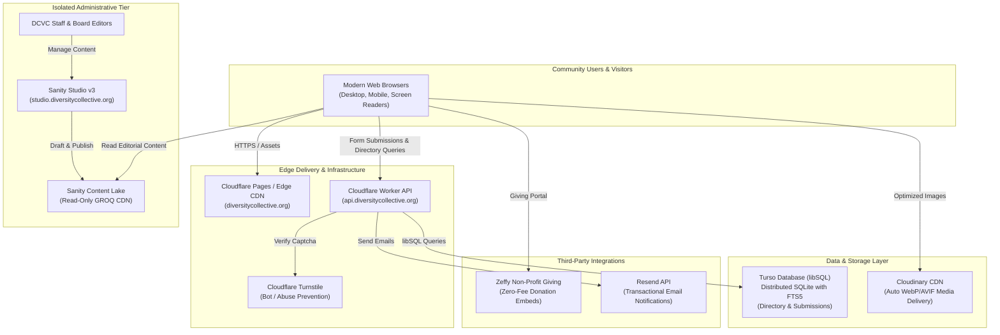

# System Architecture & Technical Design

**Project:** Diversity Collective Ventura County  
**Domain:** `diversitycollective.org`  
**Revision:** Phase 1 Complete

---

## 1. High-Level Architectural Topology

The Diversity Collective web platform utilizes a decoupled, modern Jamstack architecture designed for maximum performance, edge caching, high availability, zero maintenance overhead, and rock-solid security.

---

## 2. Admin Isolation Architecture

A core requirement of this architecture is the **strict physical separation** of the administrative CMS from the public website:

### Why Isolation is Critical:
1. **Zero Bundle Pollution**: Bundling administrative studios (e.g., Sanity Studio, React forms, schema compilers) into the public website causes substantial bundle bloat (adding 1.5MB+ of unnecessary JavaScript), significantly hurting Core Web Vitals (LCP, FID/INP).
2. **Elimination of Attack Vectors**: Public visitors never have access to `/admin` or `/studio` script chunks, reducing vulnerability surfaces.
3. **Independent Deployment Lifecycles**: Editorial team updates or schema changes in `studio/` can be deployed independently to `studio.diversitycollective.org` without triggering a rebuild or redeployment of the public user-facing application.
4. **Role-Based Access Control**: Sanity Studio handles authentication via Google Workspace / GitHub OAuth directly on Sanity's identity layer, ensuring only authorized DCVC staff with verified organizational accounts can log in.

---

## 3. Data Flow & Workflows

### 3.1 Affirming Business Directory Workflow
1. **Browsing & Search**:
   - The user visits `/directory` and enters a search query (e.g. "coffee" or "counseling") and filters by category/city.
   - The client invokes `GET https://api.diversitycollective.org/api/directory?q=coffee&city=Ventura&limit=12`.
   - The Cloudflare Worker executes a parameterized query against Turso libSQL using the `businesses_fts` FTS5 virtual table.
   - Sub-10ms response returns the matching approved records with a deterministic pagination cursor `created_at|id`.
2. **Business Submission**:
   - An affirming business owner completes the submission form at `/directory/submit` and signs the LGBTQ+ Affirming Pledge.
   - Client validates fields and requests a Cloudflare Turnstile verification token.
   - Client sends `POST /api/directory` with payload and token.
   - Worker verifies Turnstile with Cloudflare, inserts listing into Turso with `status = 'pending'`, and dispatches an email notification to `directory@diversitycollective.org` via Resend.
   - Staff logs in, reviews the business verification, and flips status to `approved`.

### 3.2 Contact & Volunteer Inquiries
1. User completes `/contact` or `/volunteer` form.
2. Client-side validation checks required fields, email format, and privacy consent.
3. Cloudflare Worker validates Turnstile token and stores application in Turso (`contact_submissions` or `volunteer_applications`).
4. Worker dispatches immediate transactional email via Resend to the responsible staff coordinator and a polite confirmation email to the applicant.
5. **Privacy Safeguard**: No clinical or health information is ever stored in shared sheets.

### 3.3 Zero-Fee Giving & Donations
1. User visits `/donate`.
2. The page embeds Zeffy's secure iFrame widget or provides direct links to Zeffy's hosted donation portal.
3. Cardholder transactions occur entirely within Zeffy's PCI-DSS Level 1 compliant environment.
4. 100% of the donation goes to Diversity Collective (Zeffy charges 0% platform fees to 501(c)(3) nonprofits).
5. No financial or credit card data ever touches the DCVC server or database.

---

## 4. Frontend Architecture

- **Framework**: React 19 + React Router DOM v7.
- **Build Tool**: Vite 6.
- **Styling**: Tailwind CSS v4 with custom brand tokens:
  - Deep Purple: `#5A1E65`
  - Vibrant Amethyst: `#692976`
  - Gold Accent: `#F59E0B`
  - Forest Emerald: `#1E5A44`
- **Dynamic SEO Management**: `usePageMeta` hook dynamically updates `document.title`, `<meta name="description">`, OpenGraph tags (`og:title`, `og:image`, `og:url`), and `<link rel="canonical">`.
- **Accessibility Engine**:
  - Semantic HTML5 structure.
  - Skip navigation link (`SkipNavigation.jsx`).
  - Native Recite Me reading aids (`ReciteReadingAids.jsx`): reading ruler, screen mask letterbox, cursor spotlight.
  - Recite Me toolbar (`ReciteToolbar.jsx`): text resizing, Dyslexic font toggle, high-contrast dark/yellow themes, pause motion.
  - Respects `prefers-reduced-motion` at the CSS and component levels.

---

## 5. Security & Compliance Architecture

| Layer | Implementation | Purpose |
| :--- | :--- | :--- |
| **Transport** | Full HTTPS / HSTS enforced via Cloudflare | Encryption in transit |
| **Bot Mitigation** | Cloudflare Turnstile (invisible & managed challenges) | Protection against spam & DDoS |
| **API Boundary** | Cloudflare Worker with strict CORS (`ALLOWED_ORIGIN`) | Blocks unauthorized cross-site requests |
| **Database** | Parameterized SQL queries via `@libsql/client/web` | Zero SQL injection vulnerability |
| **Content Security** | Strict headers (`X-Content-Type-Options`, `X-Frame-Options`) | Mitigates clickjacking and MIME sniffing |
| **Compliance** | WCAG 2.2 Level AA / Section 508 | Equal access for all disabled users |

