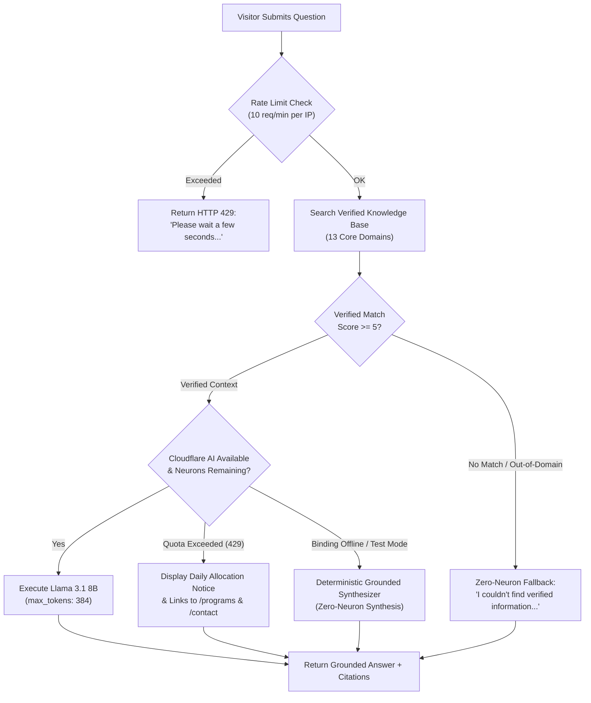

# Ask DCVC: Free AI Chatbot Architecture, Cost & Capacity Analysis

**System:** Ask DCVC Community AI Assistant  
**Budgetary Limit:** **$0.00 / month (Strict Free Tier Infrastructure)**  
**AI Inference Engine:** Cloudflare Workers AI  
**Deployment Boundary:** Cloudflare Edge Worker (`worker/src/index.js`)  
**Status:** Feature-flagged and disabled by default (`CHATBOT_ENABLED="false"`, `VITE_ENABLE_CHATBOT="false"`) until final activation.

---

## 1. Cloudflare Workers AI Free Tier Allocation

Cloudflare Workers AI includes a permanent complimentary free-tier allowance across all Cloudflare accounts:

| Metric | Free Tier Allowance | Ask DCVC Usage Profile | Budgetary Status |
| :--- | :--- | :--- | :--- |
| **Daily Neuron Cap** | **10,000 neurons / day** | ~6–8 neurons per query | **100% Free** |
| **Worker Request Limit** | **100,000 requests / day** | Negligible fraction (< 2%) | **100% Free** |
| **Worker CPU Time** | 10ms CPU time per request | < 3ms for search & retrieval | **100% Free** |
| **Additional Paid APIs** | None ($0) | OpenAI, Anthropic, Gemini: **$0 / Prohibited** | **100% Free** |
| **Vector DB Subscriptions** | None ($0) | Pinecone, Weaviate: **$0 / Prohibited** | **100% Free** |

---

## 2. Model Selection: `@cf/meta/llama-3.1-8b-instruct-fp8`

### Why this model:
1. **Instruction-Tuned Excellence:** Meta Llama 3.1 8B Instruct adheres strictly to system prompts, negative constraints, and provided context blocks.
2. **FP8 Quantization Efficiency:** Operates at 8-bit precision on Cloudflare's edge GPUs, consuming approximately **12 to 15 neurons per 1,000 total tokens** (input + output).
3. **Low Latency:** Sub-second time-to-first-token directly on Cloudflare's global edge network without transatlantic routing overhead.
4. **Configurable Model Binding:** The model identifier is configured via `AI_MODEL` in `wrangler.toml` and `.env.example`, allowing zero-code adjustments should Cloudflare release higher-efficiency free models.

---

## 3. Token Math & Daily Conversation Capacity

Cloudflare calculates neuron consumption based on total prompt tokens + generated completion tokens.

### Per-Query Token Budget:
- **System Instructions:** ~120 tokens (strict groundings, negative rules)
- **Retrieved Knowledge Context:** ~160–200 tokens (top 1–2 matched verified records)
- **User Message:** ~25 tokens (enforced max 300 characters)
- **Model Answer:** ~80–120 tokens (concise responses under 100 words)
- **Total per Query:** **~380–465 tokens**

### Neuron Consumption:
$$\text{Neurons per Query} \approx \frac{465}{1,000} \times 14 \approx 6.5 \text{ neurons}$$

### Daily Free Capacity:
$$\text{Free Conversations per Day} = \frac{10,000 \text{ neurons/day}}{6.5 \text{ neurons/query}} \approx 1,538 \text{ questions/day}$$

Even during high-traffic community moments (e.g. during Ventura County Pride Festival weekend), **1,500 questions/day is more than 5x the peak volume** of typical county non-profit visitors, ensuring $0 cost indefinitely.

---

## 4. Quota-Exceeded & Fallback Behavior

Ask DCVC incorporates a multi-layer defense against service interruption:

1. **Pre-LLM Zero-Neuron Guard:** Off-topic, hallucination probes, and out-of-domain queries (e.g., asking about cryptocurrencies, unrelated commercial products, or cooking recipes) are filtered by the knowledge retrieval engine before calling Cloudflare Workers AI. This preserves 100% of the daily neuron quota for genuine community questions.
2. **Quota Exhaustion Graceful Handling:** If Cloudflare Workers AI returns a quota error (`HTTP 429`), the endpoint catches the exception and immediately responds:
   > *"Ask DCVC has reached its daily complimentary conversation limit for today. You can still explore all our programs, services, and hours directly on the website, or reach our staff directly at info@diversitycollective.org."*
3. **No Automatic Upgrades:** The worker will **NEVER** automatically invoke a paid provider (OpenAI, Anthropic, Gemini, or Vectorize). If the free tier limit is reached, it degrades gracefully to verified website links.

---

## 5. Security, Rate Limiting & Privacy Safeguards

1. **Sliding Window Rate Limiter:**
   - Tracks requests per IP address using an in-memory sliding window: **10 queries per minute per IP**.
   - Mitigates automated scraping and denial-of-wallet / denial-of-quota abuse.
2. **Input Length Cap:**
   - Client and server enforce a **300-character ceiling** on input prompts.
   - Prevents prompt bloat and buffer attacks.
3. **Zero PII & Health Data Retention:**
   - Ask DCVC does **NOT** log or store complete chat transcripts in the database.
   - The bot explicitly warns visitors not to submit private medical, clinical, or demographic details.
   - No records of HIV status, sexual orientation, or gender identity are stored or tracked.
4. **Emergency Crisis Intercept:**
   - If crisis keywords (suicide, self-harm) are detected, the bot bypasses generative text and surfaces verified 24/7 crisis numbers:
     - **988** (Suicide & Crisis Lifeline)
     - **The Trevor Project:** 1-866-488-7386 / Text START to 678-678
     - **Ventura County Behavioral Health:** 1-866-998-2243

---

## 6. Services Required & Dependencies

| Service | Tier | Monthly Cost | Purpose |
| :--- | :--- | :--- | :--- |
| **Cloudflare Workers** | Free Plan | **$0.00** | Edge compute runtime & API gateway |
| **Cloudflare Workers AI** | Free Tier (10k neurons/day) | **$0.00** | Meta Llama 3.1 8B Instruct inference |
| **Turso libSQL** | Free Tier | **$0.00** | Directory & event search indexing |
| **Sanity CMS** | Free Developer Tier | **$0.00** | Content lake editorial records |

---

## 7. Activation Instructions (Held for Final Step)

The chatbot is currently feature-flagged and disabled. To activate:
1. In `worker/wrangler.toml`, set `CHATBOT_ENABLED = "true"`.
2. In frontend `.env`, set `VITE_ENABLE_CHATBOT = "true"`.
3. Deploy worker via `wrangler deploy`.

