# Database Design & Scaling Architecture

**Database Technology:** Turso (libSQL Distributed SQLite)  
**Schema Location:** `src/db/schema.sql`  
**Migration Path:** `src/db/migrations/`  
**Seeding:** `src/db/seed.sql` & `src/db/seed.js`

---

## 1. Overview & Architectural Motivation

The Diversity Collective Ventura County platform uses **Turso (libSQL)** as its primary transactional database. Turso provides serverless, globally distributed SQLite with sub-10ms edge read latency, zero maintenance overhead, and a generous free tier (up to 9 GB storage and 1 billion row reads/month).

Unlike traditional relational engines that require heavy connection pooling, libSQL communicates over secure HTTP/WebSocket protocols using `@libsql/client/web`, making it natively compatible with Cloudflare Workers without requiring dedicated server infrastructure.

---

## 2. Entity-Relationship Diagram

```mermaid
erDiagram
    BUSINESSES ||--o{ BUSINESS_CORRECTIONS : receives
    BUSINESSES {
        text id PK "UUID v4"
        text slug UK "Unique SEO slug"
        text name "Business Name"
        text category "Category"
        text city "Ventura County City"
        text status "pending | approved | rejected | archived"
        integer is_featured "Spotlight flag"
        integer is_verified "Staff verified flag"
        text affirming_pledge_signed_at "ISO-8601 Timestamp"
    }

    BUSINESS_CORRECTIONS {
        text id PK "UUID v4"
        text business_id FK "References businesses(id)"
        text request_type "update | ownership_claim | removal"
        text requester_email "Contact"
        text status "pending | resolved"
    }

    CONTACT_SUBMISSIONS {
        text id PK "UUID v4"
        text name "Contact name"
        text email "Email address"
        text subject "Topic"
        text message "Inquiry text"
        integer consent_given "Consent flag"
        text status "unread | resolved"
    }

    VOLUNTEER_APPLICATIONS {
        text id PK "UUID v4"
        text full_name "Applicant name"
        text email "Contact email"
        text phone "Contact phone"
        text city "City"
        text roles_of_interest "JSON array"
        integer consent_given "Consent flag"
        text status "pending | active"
    }

    TRAINING_BOOKINGS {
        text id PK "UUID v4"
        text organization_name "Company / Clinic"
        text course_id "PRIDE Course Code"
        text preferred_format "in-person | virtual | hybrid"
        integer estimated_attendees "Headcount"
        text status "inquiry_received | confirmed"
    }

    ACCESSIBILITY_FEEDBACK {
        text id PK "UUID v4"
        text page_url "Reported URL"
        text barrier_description "Issue description"
        text assistive_tech "Screen reader / browser"
        text status "open | remediated"
    }

    NEWSLETTER_SUBSCRIBERS {
        text id PK "UUID v4"
        text email UK "Subscriber email"
        integer is_active "Active flag"
        text consent_timestamp "ISO-8601 Timestamp"
    }

    EVENT_RSVPS {
        text id PK "UUID v4"
        text event_id "Event identifier"
        text attendee_name "Name"
        text attendee_email "Email"
        integer attendee_count "Count"
        text status "confirmed | waitlisted"
    }
```



---

## 3. High-Scale Architecture (Scaling to 1,000,000 Directory Listings)

Traditional web directories commonly degrade when scaled beyond 50,000 records due to naive `OFFSET` pagination and unindexed `LIKE '%query%'` text queries. This schema implements three architectural safeguards ensuring deterministic sub-10ms responses at 1,000,000 records:

### 3.1 Compound Filter Indexing
Directory visitors typically filter by status, city, and category simultaneously. We establish a composite B-Tree index:
```sql
CREATE INDEX idx_businesses_status_city_category 
    ON businesses (status, city, category);
```
- **Performance**: Queries filtering by `status = 'approved' AND city = 'Ventura' AND category = 'Dining & Coffee'` perform a single B-tree index scan, eliminating full-table scans across 1M rows.

### 3.2 Deterministic Cursor-Based Pagination
Standard `OFFSET` pagination (e.g. `LIMIT 12 OFFSET 50000`) forces the database engine to scan and discard 50,000 rows, resulting in an O(N) performance cliff.

We implement deterministic keyset/cursor pagination:
```sql
CREATE INDEX idx_businesses_cursor 
    ON businesses (status, created_at DESC, id DESC);
```
When retrieving subsequent pages, the client sends the cursor of the last visible record (`cursor = '2024-01-15 10:00:00|biz-1'`). The query evaluates:
```sql
WHERE status = 'approved'
  AND (created_at < ? OR (created_at = ? AND id < ?))
ORDER BY created_at DESC, id DESC
LIMIT 13;
```
- **Performance**: Performs an O(log N) index seek directly to the cursor point regardless of whether the user is on page 1 or page 50,000. Memory and execution time remain strictly bounded at under 8 milliseconds.

### 3.3 Full-Text Search Virtual Table (FTS5)
Substring searches like `WHERE name LIKE '%bakery%'` cannot use standard B-Tree indexes and require scanning all text columns.

We implement SQLite's FTS5 full-text engine with BM25 ranking:
```sql
CREATE VIRTUAL TABLE businesses_fts USING fts5(
    id UNINDEXED,
    name,
    description,
    category,
    city,
    content='businesses',
    content_rowid='rowid'
);
```
Triggers keep `businesses_fts` automatically synchronized with the primary `businesses` table on `INSERT`, `UPDATE`, and `DELETE`.

---

## 4. Privacy, Backups & Compliance

1. **Zero Health / Clinical Data In Shared Repositories**:
   - In adherence to HIPAA guidelines and LGBTQ+ community trust, clinical HIV/STI test results and therapy notes from Diversity SHINES are **strictly prohibited** from this database and all external Google Sheets.
2. **PCI-DSS Level 1 Compliance**:
   - No financial data, bank accounts, or credit card numbers are ever processed or stored in Turso. All transactions take place within Zeffy's compliant portal.
3. **Automated Point-in-Time Restore**:
   - Turso natively provides continuous point-in-time recovery (PITR) and automatic replication across edge locations.

