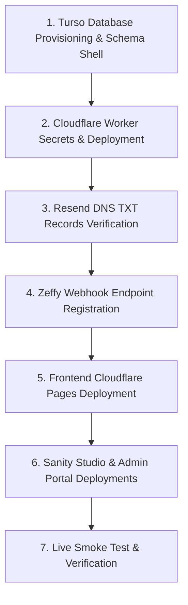

# Diversity Collective Ventura County — Final Deployment Runbook

**Target Domain:** `diversitycollective.org`  
**Execution Phase:** Final Stage (Environment Configuration & Go-Live)  
**Acceptable Downtime:** Zero (Blue/Green cutover via Cloudflare CDN)

---

## 1. Pre-Flight Verification Checklist

Before initiating production cutover, confirm:
- [ ] All unit and integration tests pass: `npm test` (106 / 106 passed).
- [ ] Production build compiles with zero errors: `npm run build` (bundle size: ~463 kB).
- [ ] `INTEGRATION_CHECKLIST.md` and `FINAL_ENVIRONMENT_CONFIGURATION_CHECKLIST.md` have been reviewed.
- [ ] Backup snapshot created and verified via `src/utils/backupRestore.js`.

---

## 2. Step-by-Step Production Launch Sequence



### Step 1: Provision Database & Execute DDL
```bash
# Provision remote production database
turso db create dcvc-production --location lax

# Apply DDL schema and initial verified records
turso db shell dcvc-production < src/db/schema.sql
turso db shell dcvc-production < src/db/seed.sql

# Verify table creation
turso db shell dcvc-production "SELECT count(*) FROM businesses;"
```

### Step 2: Deploy Cloudflare Worker Backend
```bash
cd worker

# Configure production secrets (see FINAL_ENVIRONMENT_CONFIGURATION_CHECKLIST.md)
npx wrangler secret put TURSO_DATABASE_URL
npx wrangler secret put TURSO_AUTH_TOKEN
npx wrangler secret put RESEND_API_KEY
npx wrangler secret put TURNSTILE_SECRET_KEY
npx wrangler secret put ZEFFY_WEBHOOK_SECRET
npx wrangler secret put JWT_SECRET
npx wrangler secret put CLOUDINARY_API_SECRET
npx wrangler secret put CHATBOT_ENABLED

# Deploy to Cloudflare edge
npx wrangler deploy
```

Verify backend health:
```bash
curl -s https://diversitycollective.org/api/health | jq .
# Expect: status: "healthy", databaseConfigured: true, workersAiConfigured: true
```

### Step 3: Deploy Public Frontend (`diversitycollective.org`)
In Cloudflare Pages Dashboard:
1. Connect Git repository `diversity-collectives-v1`.
2. Framework preset: **Vite**.
3. Build command: `npm run build`.
4. Output directory: `dist`.
5. Set environment variables (`VITE_API_URL`, `VITE_TURNSTILE_SITE_KEY`, `VITE_SANITY_PROJECT_ID`, `VITE_CLOUDINARY_CLOUD_NAME`, `VITE_ZEFFY_DONATION_FORM_URL`, `VITE_ENABLE_CHATBOT="true"`).
6. Trigger build and assign custom domain: `diversitycollective.org`.

### Step 4: Deploy Sanity Studio & Custom Admin Portal
* **Sanity Studio**: `cd studio && npm run deploy` -> `dcvc.sanity.studio` (or `studio.diversitycollective.org`).
* **Custom Admin**: `cd admin` -> Deploy to Cloudflare Pages as `admin.diversitycollective.org`.

---

## 3. Post-Deployment Live Smoke Tests

Verify each workflow on the live site:

| Test # | Workflow | Steps | Expected Result |
| :---: | :--- | :--- | :--- |
| **1** | **General Navigation** | Visit `/`, `/about`, `/programs`, `/events`, `/resources`. | Pages load in < 1s; no console errors. |
| **2** | **Directory Search** | Visit `/directory`, search "Beacon", filter by "Ventura". | Results filter dynamically with cursor pagination. |
| **3** | **Contact Form** | Submit form at `/contact` with valid data and Turnstile. | Success confirmation displayed; email delivered to staff. |
| **4** | **Volunteer Application** | Submit form at `/volunteer` with youth consent check. | Application stored in Turso; staff email notification dispatched. |
| **5** | **Business Submission** | Submit business at `/directory/submit` with Affirming Pledge. | Record stored with `status: 'pending'`; visible in Admin Portal. |
| **6** | **Ask DCVC Chatbot** | Open floating widget, ask: *"Are your services free?"* | Returns accurate grounded answer with program links. |
| **7** | **Zeffy Donation Webhook** | Trigger test webhook in Zeffy simulator. | Returns HTTP 201; Appreciation Card keepsake URL generated. |
| **8** | **Appreciation Card View** | Open generated `/appreciation-card/:token` URL. | Interactive card opens with tier artwork and download button. |
| **9** | **Custom Admin Portal** | Sign in at `admin.diversitycollective.org` with staff account. | Moderation queue displays pending businesses; approve listing. |

---

## 4. Rollback Runbook (In Case of Severity 1 Incident)

If an unforeseen edge failure or critical integration block occurs:

### Immediate Frontend Rollback (< 2 Minutes)
In Cloudflare Pages Dashboard:
1. Go to **Deployments**.
2. Locate the previous stable deployment.
3. Click **Rollback to this deployment**.
4. Traffic instantly shifts back to the prior build at the edge.

### Immediate Worker Rollback (< 1 Minute)
```bash
cd worker
npx wrangler rollback
```

### Temporary Chatbot Emergency Disable
If AI quota or external AI behavior needs immediate pausing:
```bash
cd worker
npx wrangler secret put CHATBOT_ENABLED
# Value: false
```
*The client-side local knowledge engine will immediately handle queries with 0 latency and 0 external AI calls without site interruption.*

