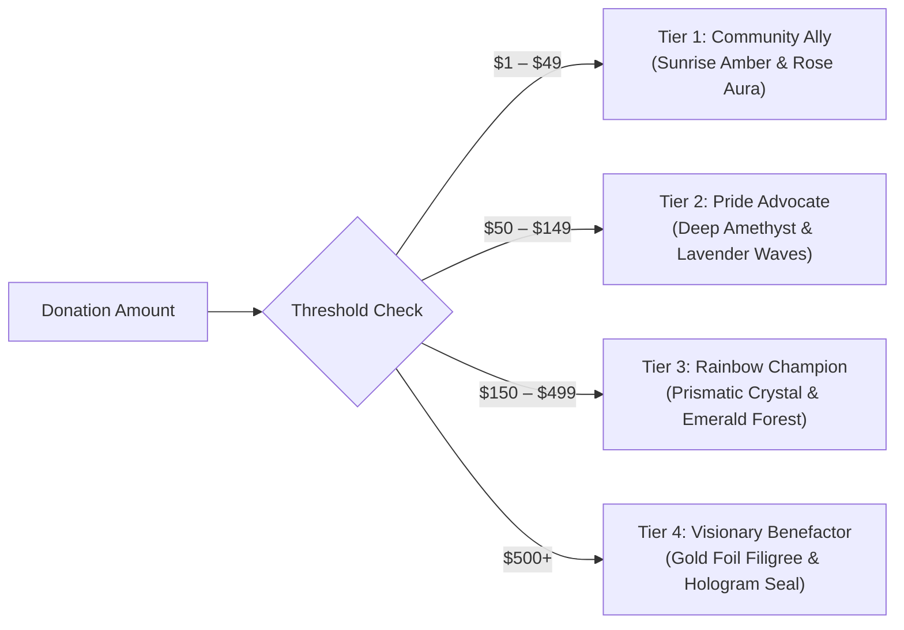
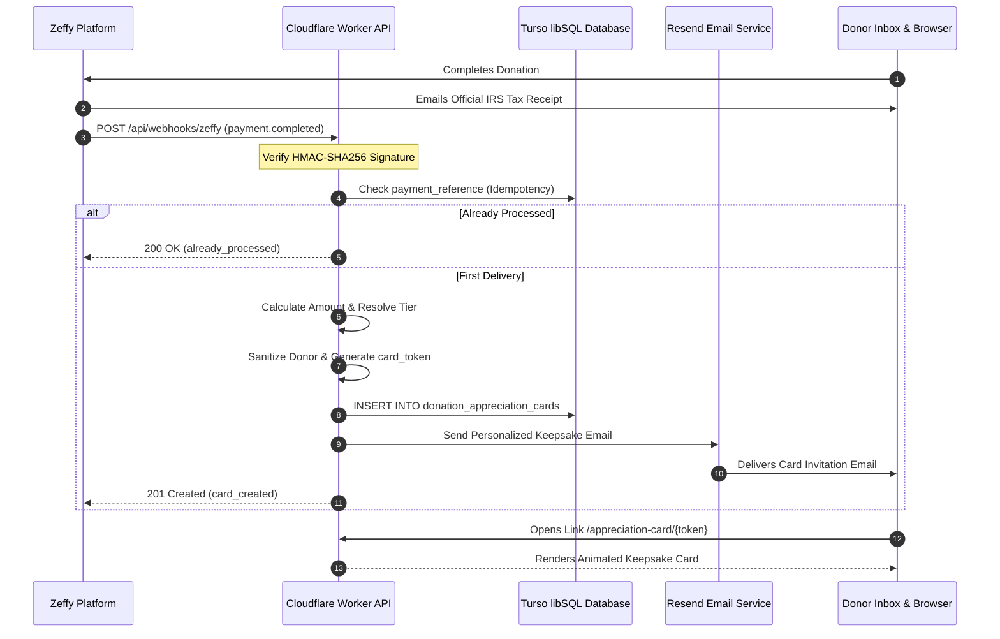

# DCVC Zeffy Donation Integration & Appreciation Cards Architecture

**Domain:** `https://diversitycollective.org`  
**API Endpoint:** `https://api.diversitycollective.org/api/webhooks/zeffy`  
**Card Viewer Route:** `https://diversitycollective.org/appreciation-card/:token`

---

## 1. Overview & Architectural Vision

Diversity Collective Ventura County (DCVC) processes charitable donations through **Zeffy**, the premier zero-fee fundraising platform exclusively for 501(c)(3) non-profit organizations. 

Unlike traditional merchant processors that deduct 3% to 5% from charitable gifts, Zeffy disburses 100% of donor funding directly to DCVC programs (such as free rapid HIV/STI testing, Rainbow Umbrella youth circles, and the Community Resource Center).

To provide donors with an immediate, heartwarming, and culturally meaningful connection to the community their gift supports, we have created **DCVC Appreciation Cards**—an automated system that generates a personalized, animated digital keepsake for every successfully completed donation.

---

## 2. Separation of Concerns: Tax Receipts vs. Appreciation Keepsakes

In strict adherence to IRS guidelines and donor clarity:

1. **Official IRS Tax Receipt**:
   - Issued **directly and immediately by Zeffy** via email upon transaction completion.
   - Contains formal legal disclosures for Diversity Collective Ventura County, Inc. (EIN: `46-5312131`, CA Corp: `C3666108`).
   - Verifies the tax-deductible contribution amount and certifies that no goods or services were exchanged.
2. **DCVC Appreciation Card**:
   - Delivered **via Resend** from `Diversity Collective <noreply@diversitycollective.org>`.
   - Serves as an artistic, interactive digital certificate of gratitude featuring messages from youth and visitors, leadership signatures (Executive Director Tess Allen & Board President Roland Catabona), and impact breakdowns.
   - Disclaims explicitly: *"This appreciation card is a cultural keepsake of gratitude. Your official 501(c)(3) tax receipt has been delivered separately by Zeffy."*

---

## 3. Four Configurable Appreciation Tiers

Every donation unlocks an appreciation card, regardless of size. Larger contributions unlock increasingly elaborate visual treatments:



| Tier Name | Recognition Circle | Default Threshold | Config Variable | Visual Treatment & Impact Narrative |
| :--- | :--- | :---: | :--- | :--- |
| **Community Ally** | Friend of Sanctuary | **\$1+** | `APPRECIATION_TIER_1_MIN` | Soft sunrise gradient, radiant gold border, floating particles. Funds safer-sex kits, harm reduction supplies, and drop-in computer lab access. |
| **Pride Advocate** | Advocate Circle | **\$50+** | `APPRECIATION_TIER_2_MIN` | Deep amethyst & fuchsia waves, pulsing pride emblem. Directly funds free rapid HIV/STI testing clinics and PrEP/PEP care navigation. |
| **Rainbow Champion** | Champion Circle | **\$150+** | `APPRECIATION_TIER_3_MIN` | Prismatic refraction, emerald forest crest, sparkling stars. Underwrites weekly Rainbow Umbrella and Little Unicorns youth circles. |
| **Visionary Benefactor** | Visionary Circle | **\$500+** | `APPRECIATION_TIER_4_MIN` | Opulent gold foil border, rotating golden seal, celebratory particle burst. Anchors flagship Community Resource Center operations. |

---

## 4. Webhook Architecture & Idempotency Guarantees

The Cloudflare Worker exposes a hardened webhook receiver at `POST /api/webhooks/zeffy`.



### 4.1 Signature Verification (HMAC-SHA256)
All inbound webhooks are signed with an HMAC-SHA256 hash in the `X-Zeffy-Signature` header. The Worker validates this signature in constant-time using `crypto.subtle` against `ZEFFY_WEBHOOK_SECRET`:
```javascript
const signatureBuffer = await crypto.subtle.sign('HMAC', key, encoder.encode(rawBody));
```

### 4.2 Idempotency Against Delivery Retries
Zeffy automatically retries webhook dispatch upon network hiccups. To prevent duplicate card generation or repeated donor emails:
1. The unique Zeffy transaction ID is stored in `donation_appreciation_cards.payment_reference` (indexed with a `UNIQUE` constraint).
2. The Worker queries `payment_reference` before doing any work.
3. If an existing record is found, the Worker immediately returns `200 OK` `{ status: 'already_processed' }` and halts execution.

### 4.3 Anonymous Giving & Privacy Protection
- If a donor marks their gift as anonymous (`is_anonymous: true`), their display name on the card is automatically scrubbed to **"Affirming Friend of DCVC"**.
- The donor's plain email address is **never exposed** through public endpoints.
- The public card retrieval endpoint (`GET /api/appreciation-cards/:token`) serves sanitized data containing only the card token, tier name, display name, and impact statement.

---

## 5. Frontend Card-Opening Experience

Implemented in `src/pages/AppreciationCard.jsx`:

1. **Interactive Sealed Presentation**:
   - Donors arrive at `https://diversitycollective.org/appreciation-card/:token`.
   - The card is initially presented inside a sealed digital presentation box with an embossed, glowing wax seal matching their tier color.
2. **Unsealing & Confetti Animation**:
   - Donors click or activate via keyboard ("Break the Seal & Open Card").
   - The seal breaks with a smooth reveal animation.
   - An ambient confetti celebration bursts across the screen (`canvas-confetti`).
   - **Accessibility & Reduced Motion**: Automatically checks `prefers-reduced-motion: reduce`. If enabled, particle bursts and pulsing flashes are completely disabled.
3. **Card Inscription & Signatures**:
   - Certificate of Authentic Gratitude inscribed to the donor's name.
   - Verified impact description and inspirational community quote.
   - Formal signatures from Executive Director Tess Allen and Board President Roland Catabona.
   - Official 501(c)(3) seal with EIN `46-5312131`.
4. **Keepsake Actions**:
   - **Download / Print**: Generates a clean printable PDF / keepsake image.
   - **Share Card**: Generates a sanitized public link for sharing to social media without exposing donor contact info.
   - **Explore Programs**: Directly links donors to `/programs` to see their investment in action.

---

## 6. Zeffy Account Setup Instructions for DCVC Administrators

To connect Zeffy to the live webhook once deployed in Phase 2:

1. **Log in to Zeffy**:
   - Navigate to [zeffy.com](https://www.zeffy.com) and log in with DCVC credentials.
2. **Access Webhook Settings**:
   - Go to **Settings > Integrations > Webhooks** (or Developer Settings).
3. **Add Webhook Endpoint**:
   - **Payload URL**: `https://api.diversitycollective.org/api/webhooks/zeffy`
   - **Events to subscribe**: `payment.completed`, `donation.completed`
   - **Secret**: Generate a secure webhook secret string.
4. **Configure Worker Secret**:
   - In terminal, execute:
     ```bash
     cd worker
     wrangler secret put ZEFFY_WEBHOOK_SECRET
     ```
   - Paste the webhook secret generated from Zeffy.
5. **Set Donation Form URL**:
   - In `.env` or Cloudflare Pages settings, set:
     ```ini
     VITE_ZEFFY_DONATION_FORM_URL=https://www.zeffy.com/donation-form/[your-slug]
     ```
6. **Simulate a Test Card**:
   - In local development or preview, navigate to `https://diversitycollective.org/appreciation-card/preview` to test all 4 tier visual presentations.

